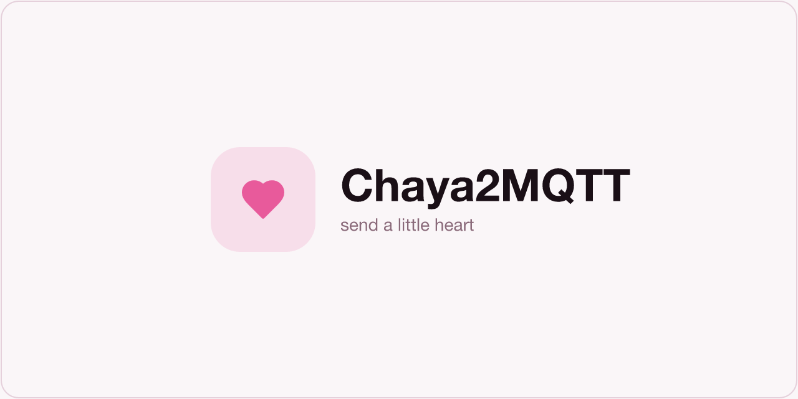

  

Sprachen: [🇬🇧](../../README.md) | **🇩🇪**

Schick jemandem Besonderem ein kleines Herz—egal wie weit weg.

Chaya2MQTT verbindet zwei Personen über [Waveshare ESP32-S3 E-Paper-Displays](https://docs.waveshare.com/ESP32-S3-ePaper-1.54G)—jede Person kann mehrere Boards haben (Zuhause, Büro, …).

Drück den Knopf auf deinem, und auf ihrem erscheint ein rotes Herz.

Jedes Display zählt die Herzen, die du gesendet und empfangen hast—MQTT trägt sie leise zwischen euch hin und her.

### Produkt

| Online                                               | Produkttitel                                         | SoftAP-Setup                                  | Offline                                                  | Ausschalten                                   |
| ---------------------------------------------------- | ---------------------------------------------------- | --------------------------------------------- | -------------------------------------------------------- | --------------------------------------------- |
|  |  |  |  |  |

> [!NOTE]
> Öffne den [Web-Flasher](https://eyjunge1.github.io/chaya2mqtt/) in Chrome oder Edge, schließe USB-C an und installiere.

## Lizenz

[GNU GPL v3.0 only](../../LICENSE)
