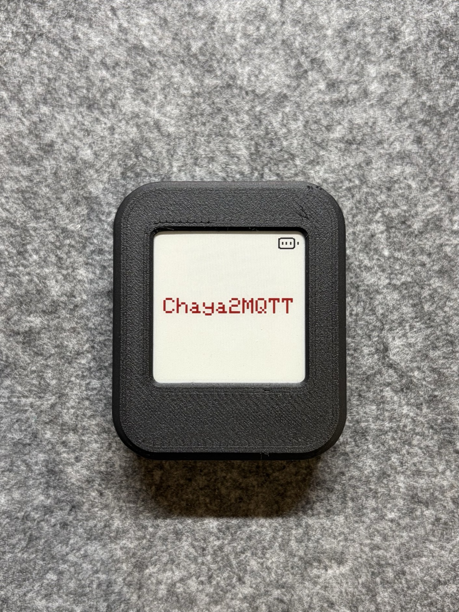
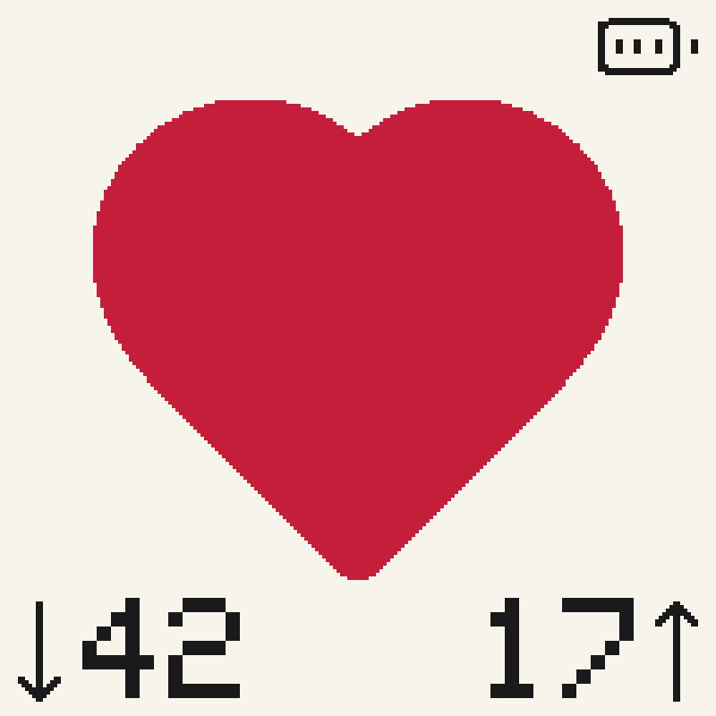
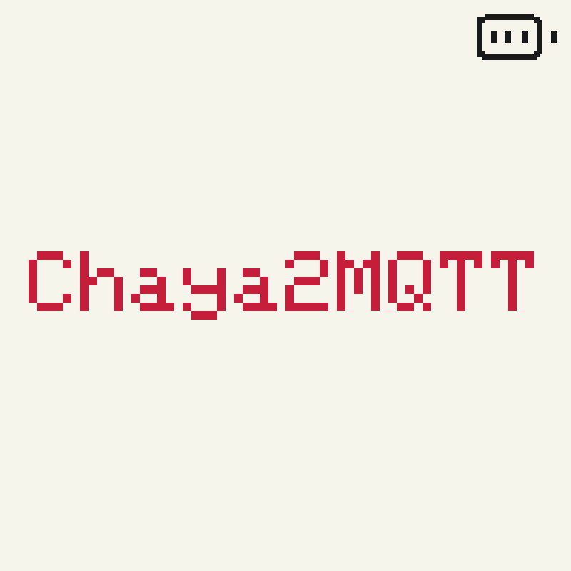

  

Languages: **🇬🇧** | [🇩🇪](./.github/i18n/README.de.md)

Send a little heart to someone special—no matter how far away they are.

Chaya2MQTT pairs two people over [Waveshare ESP32-S3 e-paper displays](https://docs.waveshare.com/ESP32-S3-ePaper-1.54G)—each can have more than one board (home, office, …).

Press the button on yours and a red heart appears on theirs.

Every display keeps track of the hearts you have sent and received, while MQTT quietly carries them between you.

### Product

| Online                                                    | Product title                                             | SoftAP setup                                       | Offline                                                       | Power-off                                          |
| --------------------------------------------------------- | --------------------------------------------------------- | -------------------------------------------------- | ------------------------------------------------------------- | -------------------------------------------------- |
|  |  |  |  |  |

> [!NOTE]
> Open the [web flasher](https://eyjunge1.github.io/chaya2mqtt/) in Chrome or Edge, connect USB-C, and install.

### Case

Printable snap-fit case (battery + USB-only): [MakerWorld](https://makerworld.com/de/models/3505578-waveshare-esp32-s3-epaper-1-54-case-chaya2mqtt#profileId-4005122).

Remove the rear SPI header and the speaker before assembly.

## License

[GNU GPL v3.0 only](LICENSE)
